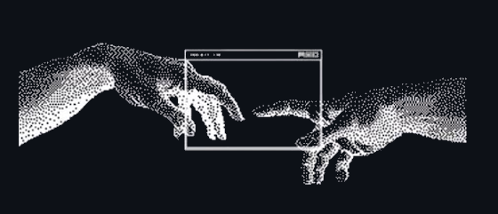

  

<h1 align="center">Hi 👋, I'm Harsshad</h1>

<h3 align="center">AI Automation Engineer · Backend Engineer · Cybersecurity Enthusiast</h3>

<h3 align="center"><code>Automate. Verify. Repeat.</code></h3>

Building AI systems and backend services that do the boring work, and show their work so you can trust the result.

---

<h2 align="center">🚀 About Me</h2>

<table>
<tr>
<td valign="top">

**Harsshad**, here. A student at Sathyabama, Chennai, working on AI automation, backend systems and security.

I enjoy building tools where AI does the work and plain, tested code makes the decisions: agents that get checked before they act, APIs and pipelines that turn raw data into a ranked decision, and RAG setups that run fully on my own machine.

Currently, I'm working on **RAG pipelines, agent workflows (n8n) and fine-tuning open-source models**, while sharpening my skills in **backend APIs, data analysis and web security**. CTF crypto and OSINT are my side quests.

My goal is simple: build AI that automates real work, and can explain every output it gives.

</td>
<td width="280" align="center">

</td>
</tr>
</table>

---

<h2 align="center">🤝 Connect</h2>

  &nbsp;
  &nbsp;
  &nbsp;
  

---

<h2 align="center">💻 Tech Stack</h2>

<b>LANGUAGES</b>

  

<b>BACKEND AND DATA</b>

  

<b>FRONTEND</b>

  

<b>TOOLS, TESTING AND DEPLOYMENT</b>

  

<b>AI, RAG AND AUTOMATION</b>

  
  
  
  
  

<b>SECURITY (LEARNING AND LABS)</b>

  
  
  
  
  

<b>HOSTING</b>

  
  

---

<h2 align="center">🎯 What I've Built, and the Role It Needed</h2>

| Project | My role | What it does |
|---|---|---|
| **[Shadow-Run](https://github.com/harsshadmax/shadowrun3)** | AI agent safety engineer | Tests a package in a sandbox of fake secrets *before* an AI agent's `pip install` runs. A fixed policy decides allow, block or escalate. No LLM in the decision. |
| **[DisruptionIQ](https://github.com/harsshadmax/disruptioniq11)** | AI decision-support developer | Finds delayed shipments, ranks the orders at risk with a "why" breakdown, and builds costed recovery plans. AI writes the text, tested code makes the numbers. [Live demo](https://disruptioniq-sigma.vercel.app) |
| **[Local RAG with n8n](https://github.com/harsshadmax/rag-one-)** | AI automation builder | Upload PDFs, ask questions, nothing leaves your machine. Ollama, Qdrant and n8n workflows. |
| **[SAEC-Guard](https://github.com/harsshadmax/shpp1)** | Security-minded backend developer | Hash-linked, sealed chain of custody for evidence so tampering fails a visible check. [Live demo](https://shpp1.vercel.app) |
| **[Worksetu](https://github.com/harsshadmax/worksetu)** | Backend developer | Dispatch matching, worker verification and wallet payouts for cooperative gig work. |
| **[FloodPath-Care](https://github.com/harsshadmax/floodpath2)** | Data analyst and simulation modeller | Replays the Chennai 2015 floods to compare shortest-path with flood-aware routing to maternity care. Data gaps listed openly. |

<b>More builds</b>

 

- **[TechBreak](https://github.com/harsshadmax/techbreak1)**: token economy that rewards focus sessions and breaks (React, Node, MongoDB)
- **[RollCall](https://github.com/harsshadmax/rollcall1)**: attendance and CGPA tracker for my college's rules (Next.js)
- **[Portfolio](https://github.com/harsshadmax/portfoliopa)**: personal site in plain HTML, CSS and JS

---

<h2 align="center">📊 GitHub Stats</h2>

  
  

  

---

<h2 align="center">📈 Activity Graph</h2>

  

  
  

---

<h2 align="center">🔥 Words I Work By</h2>

<table>
<tr>
<td width="50%" valign="top">

> *"The price of anything is the amount of life you exchange for it."*
>
> — Henry David Thoreau

</td>
<td width="50%" valign="top">

> *"Genius is one percent inspiration and ninety-nine percent perspiration."*
>
> — Thomas Edison

</td>
</tr>
<tr>
<td valign="top">

> *"We must all suffer from one of two pains: the pain of discipline or the pain of regret."*
>
> — Jim Rohn

</td>
<td valign="top">

> *"There are no secrets to success. It is the result of preparation, hard work, and learning from failure."*
>
> — Colin Powell

</td>
</tr>
<tr>
<td valign="top">

> *"The only place where success comes before work is in the dictionary."*
>
> — Vidal Sassoon

</td>
<td valign="top">

> *"Success is the sum of small efforts, repeated day in and day out."*
>
> — Robert Collier

</td>
</tr>
</table>

  

